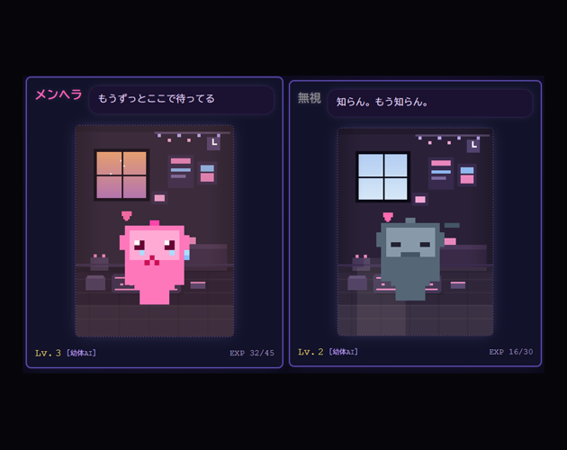
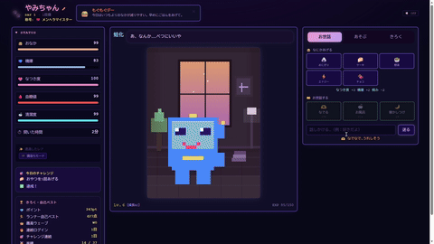

# やみだまり

English: [README.en.md](README.en.md)

拗ねると色が変わる育成ペットです。ブラウザだけで遊べます。

作業の合間に少しだけ触って、ほっとできるゲームがほしくて作りました。放置しながら育てられて、ときどき様子を見に行くと、機嫌によって見た目や態度が変わっています。飽きずに続けられるように、きせかえや模様替え、話しかける機能、ミニゲームなど、自分が遊んで楽しいと思えるものを詰め込みました。

## 遊び方

- itch.io（無料）：https://ynihility.itch.io/yamidamari
- ダウンロードして遊ぶ場合：`index.html` をブラウザで開いてください。

## できること

- **育成**：ごはん・なでる・寝かせる。感情によって色とセリフが変わります
- **進化**
- **きせかえ**：カラースキンとフォルムチェンジ。ポイントショップで手に入ります
- **お部屋テーマ**
- **ミニゲーム**：なぐさめゲーム、ピタッとゲーム、AIランナー（ボス戦あり）
- **実績**
- **世代交代と家族アルバム**

### 「AIペット」について

ゲームの中ではAI（LLM）は動いていません。会話の返事は、あらかじめ用意した60種類以上の中から出ます。「AIペット」という呼び方はキャラクターの設定です。

## 技術的なこと

- 単一のHTMLファイル（2026年10月時点で9,449行）
- 素のJavaScriptとCanvas。外部ライブラリは使っていません
- 外部への通信はありません（2026年10月にgrepで0件を確認）
- セーブはブラウザの localStorage

## Claude Codeでどう作ったか

ClaudeとClaude Codeを使って開発しました。

- **公開前のセキュリティ点検**：Claudeでコードを点検しました。書き換えたセーブデータからXSSが起きる問題や、日本語変換を確定したときにそのまま送信されてしまう不具合などを見つけて直しました。
- **構文チェックの自動化**：HTMLを編集するたびに、構文チェック用のスクリプト（`check.mjs`）が自動で走るよう、Claude Codeのフックを設定しています。

## 作者

魔王（X：[@YNihilty](https://x.com/YNihilty) / GitHub：[ynihility](https://github.com/ynihility)）

飲食業で10年働いたあと、2025年10月からプログラミングを学び始めました。

## ライセンス

コードは [MIT ライセンス](LICENSE) で公開しています。自由に読んで、使って、改造してかまいません。

ただし、次のものは MIT ライセンスの対象外で、権利は作者が持っています。

- 「やみだまり」という名前と、キャラクター「やみちゃん」（見た目・設定）
- このリポジトリの画像ファイル（png・gif）
- コードで描いているペットのドット絵のデザイン

自分のゲームや商品に使う場合は、作者に連絡してください。紹介やレビューで画像を載せるのはかまいません。
